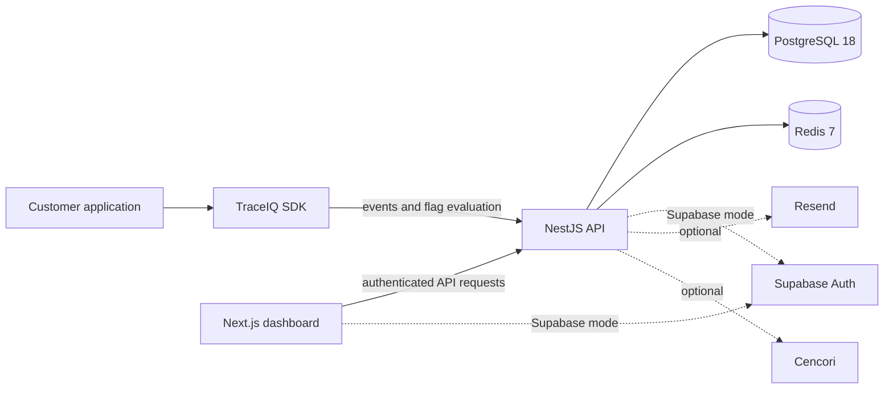
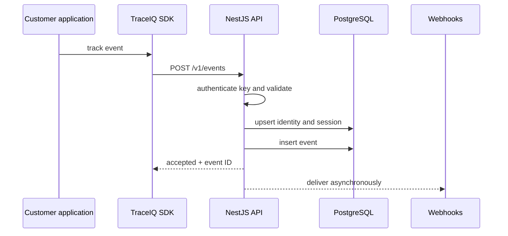

# Architecture

TraceIQ is a multi-language analytics platform built around a TypeScript monorepo. PostgreSQL is the system of record for application and event data.

## Runtime components

- `apps/api` is the NestJS ingestion and dashboard API. Domain modules own authentication, organizations, projects, events, analytics, funnels, cohorts, flags, alerts, webhooks, exports, and related behavior.
- `apps/dashboard` is the Next.js public site, documentation UI, and authenticated analytics dashboard.
- `packages/sdk-js`, `packages/node`, and `packages/react-native` collect application events.
- `packages/types`, `packages/shared`, and `packages/ui` contain reusable TypeScript contracts and UI code.
- `packages/mcp-server` exposes selected TraceIQ operations through the Model Context Protocol.
- `sdks` contains the Python, Rust, Swift, and Kotlin SDKs. The PHP SDK is at the repository root.

## Event ingestion

The current ingestion path writes validated events directly to PostgreSQL. Redis is available for queue-backed features and future background processing, but the public architecture should not assume a separate ingestion worker.

## Identity and tenancy

Organizations contain projects and members. Each project owns its users, sessions, events, write keys, analytics definitions, and operational configuration. Browser SDK traffic is authenticated with a project write key; dashboard requests use Supabase bearer tokens and server-side authorization checks.

An event can carry a stable `userId`, an `anonymousId`, and a `sessionId`. When an anonymous visitor becomes identified, TraceIQ stitches compatible historical activity to the user record.

## Data and optional providers

PostgreSQL 18 stores both operational and analytical data. This keeps a self-hosted installation understandable and avoids requiring a separate analytics database. Redis 7 is included in the deployment stack. Cencori-backed AI features and Resend-backed email delivery are optional and degrade gracefully when their keys are absent.

Authentication has two modes. `local` supplies a deterministic single owner for a private loopback installation; `supabase` provides accounts, teams, invitations, sessions, and 2FA. Both modes use the same server-side organization, role, and project authorization checks.

## Deployment boundary

The API, PostgreSQL, and Redis can run together in Docker Compose. The dashboard is a separate Next.js deployment and can run locally, on Vercel, or on another Node.js host. A reverse proxy terminates TLS and forwards only the API port; PostgreSQL and Redis remain private.

See [Deployment](deployment.md) for an operational guide and [Event schema](event-schema.md) for the ingestion contract.
